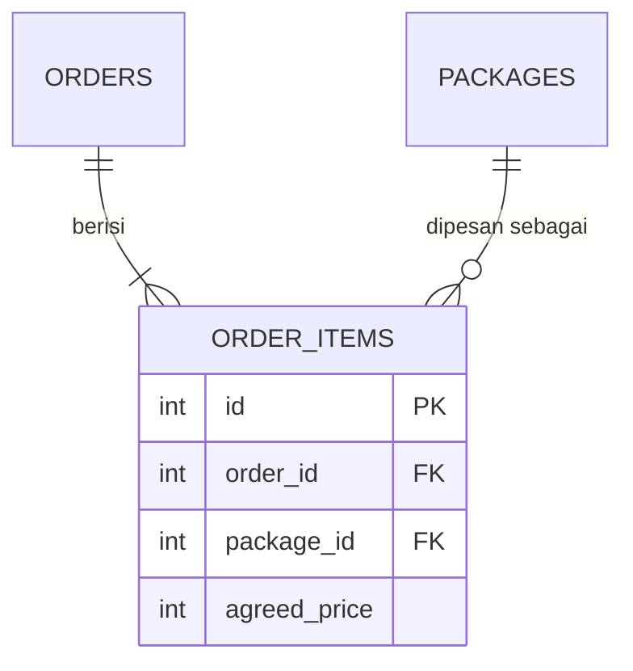

# Contoh Jawaban Soal 01: Membaca ERD

> Buka hanya setelah semua nomor kamu jawab sendiri. Kalimatmu boleh berbeda;
> yang dibandingkan adalah alasannya.

## A. Membaca hubungan

**1.**

| Garis | Arah 1 | Arah 2 |
|---|---|---|
| users – orders | Satu user membuat nol atau banyak order. | Satu order dibuat oleh tepat satu user. |
| packages – orders | Satu paket dipilih dalam nol atau banyak order. | Satu order memilih tepat satu paket. |
| orders – payments | Satu order dibayar lewat nol atau banyak payment. | Satu payment milik tepat satu order. |
| orders – order_status_logs | Satu order punya nol atau banyak log status. | Satu log milik tepat satu order. |
| users – order_status_logs | Satu user mengubah status nol atau banyak kali. | Satu log diubah oleh tepat satu user. |
| users – payments | Satu user mencatat nol atau banyak payment. | Satu payment dicatat oleh tepat satu user. |

**2.** Satu kolom hanya bisa menyimpan satu nilai. Kalau `users.order_id`, satu
user hanya bisa punya satu pesanan. Untuk pesanan kedua kamu harus menduplikasi
baris user, lalu email tidak bisa lagi `UNIQUE`. Karena itu FK selalu di sisi
"banyak".

**3.** `payments.recorded_by` dan `order_status_logs.changed_by` adalah jejak
audit: siapa yang mencatat pembayaran dan siapa yang mengubah status. Klien dan
admin punya data yang sama (nama, email, password) dan cara login yang sama,
jadi cukup satu tabel dibedakan `role`. Catatan: database tidak memaksa
`recorded_by` harus admin. Aturan itu harus dicek di aplikasi.

## B. Menebak alasan desain

**4.** US-03: "Harga yang disepakati adalah harga paket saat pesanan dibuat."
Tanpa `agreed_price`, kalau admin menaikkan harga paket bulan depan, tagihan
semua pesanan lama ikut berubah dan sisa tagihan jadi salah. Harga di `packages`
adalah harga *sekarang*; harga di `orders` adalah harga *saat transaksi*.

**5.** Satu pesanan bisa dibayar beberapa kali (DP lalu pelunasan). Dengan satu
kolom `paid_amount`, yang hilang antara lain: tanggal tiap pembayaran, metode,
bukti, dan siapa yang mencatat. Kamu juga tidak bisa memperbaiki satu pembayaran
yang salah input tanpa merusak totalnya.

**6.** `orders.package_id` menunjuk ke `packages.id`. Secara default PostgreSQL
akan **menolak** `DELETE` itu (foreign key violation). Kalau FK dibuat
`ON DELETE CASCADE`, pesanan ikut terhapus, dan kalau `ON DELETE SET NULL`, kita
tidak tahu lagi paket apa yang dulu dipesan. Menonaktifkan (`is_active = false`)
menyembunyikan paket dari katalog tanpa merusak riwayat.

**7.** Log pertama dibuat saat pesanan lahir dengan status `baru`. Sebelumnya
tidak ada status apa pun, jadi `from_status` kosong.

## C. Dari ERD ke SQL

**8.**

```sql
SELECT o.id, p.name AS package_name, o.status, o.created_at
FROM orders o
JOIN packages p ON p.id = o.package_id
WHERE o.user_id = 7
ORDER BY o.created_at DESC;
```

**9.**

```sql
SELECT
  o.id,
  o.agreed_price,
  COALESCE(SUM(pay.amount), 0)                  AS total_paid,
  o.agreed_price - COALESCE(SUM(pay.amount), 0) AS remaining
FROM orders o
LEFT JOIN payments pay ON pay.order_id = o.id
GROUP BY o.id, o.agreed_price
ORDER BY o.id;
```

`LEFT JOIN` dipakai karena pesanan tanpa pembayaran tidak punya baris di
`payments`. `INNER JOIN` akan membuang pesanan itu dari hasil. `SUM` atas nol
baris menghasilkan `NULL`, jadi dibungkus `COALESCE(..., 0)`.

**10.**

```sql
CREATE TABLE orders (
  id               SERIAL PRIMARY KEY,
  user_id          INTEGER NOT NULL REFERENCES users(id),
  package_id       INTEGER NOT NULL REFERENCES packages(id),
  agreed_price     INTEGER NOT NULL CHECK (agreed_price >= 0),
  brief            TEXT    NOT NULL CHECK (char_length(brief) BETWEEN 1 AND 2000),
  desired_deadline DATE    NOT NULL,
  status           TEXT    NOT NULL DEFAULT 'baru'
                   CHECK (status IN ('baru', 'dikonfirmasi', 'dikerjakan',
                                     'review_klien', 'selesai', 'dibatalkan')),
  created_at       TIMESTAMPTZ NOT NULL DEFAULT now(),
  updated_at       TIMESTAMPTZ NOT NULL DEFAULT now()
);

CREATE TABLE payments (
  id          SERIAL PRIMARY KEY,
  order_id    INTEGER NOT NULL REFERENCES orders(id),
  amount      INTEGER NOT NULL CHECK (amount > 0),
  method      TEXT    NOT NULL CHECK (method IN ('transfer', 'tunai')),
  paid_at     DATE    NOT NULL,
  proof_url   TEXT,
  recorded_by INTEGER NOT NULL REFERENCES users(id),
  created_at  TIMESTAMPTZ NOT NULL DEFAULT now()
);

CREATE INDEX idx_orders_user_id ON orders(user_id);
CREATE INDEX idx_payments_order_id ON payments(order_id);
```

Aturan "deadline minimal 14 hari dari hari ini" tidak ditaruh sebagai `CHECK`
karena relatif terhadap tanggal hari ini. `CHECK` hanya dievaluasi saat baris
ditulis, jadi aturan itu divalidasi di aplikasi. PostgreSQL juga tidak otomatis
membuat index untuk kolom FK, jadi index ditambahkan sendiri.

## D. Perubahan

**11.** Hubungan orders–packages berubah dari 1–N menjadi N–N, jadi butuh tabel
perantara.



`orders.package_id` dan `orders.agreed_price` pindah ke `order_items`, karena
setiap paket dalam satu pesanan punya harga sepakatnya sendiri. Total tagihan
pesanan menjadi `SUM(order_items.agreed_price)`. Perhatikan `||--|{`: satu order
berisi **satu atau banyak** item, tidak boleh nol.
