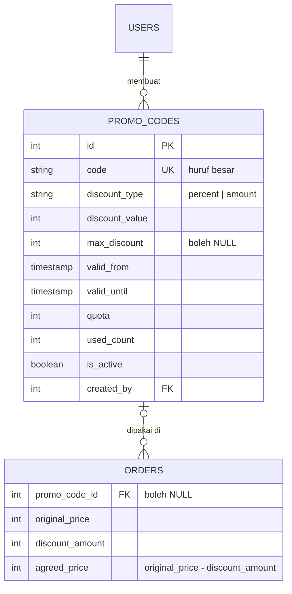

# Contoh Jawaban Soal 03: Fitur Kode Promo

> Ini salah satu rancangan yang masuk akal, bukan satu-satunya. Asumsi yang
> berbeda akan menghasilkan rancangan berbeda, dan itu wajar.

## 1. Pertanyaan klarifikasi

1. Kode berlaku untuk semua paket atau paket tertentu saja?
2. Kuota itu total untuk semua klien, atau juga dibatasi per klien?
3. Kalau pesanan yang memakai promo dibatalkan, kuotanya kembali?
4. Apakah diskon persen punya batas maksimal nominal?
5. Kalau diskon nominal lebih besar dari harga paket, apa yang terjadi?
6. Huruf besar/kecil dibedakan (`awaltahun` sama dengan `AWALTAHUN`)?
7. Masa berlaku memakai zona waktu apa?
8. Apakah klien bisa melihat harga setelah diskon sebelum menekan "Pesan"?
9. Apakah admin bisa menonaktifkan kode sebelum masa berlakunya habis?

## 2. Asumsi (bukan keputusan PM)

1. Berlaku untuk semua paket.
2. Kuota total, dan satu klien hanya boleh memakai satu kode yang sama satu kali.
3. Pembatalan tidak mengembalikan kuota.
4. Diskon persen boleh punya `max_discount` (opsional).
5. Harga setelah diskon minimal 0, tidak pernah negatif.
6. Tidak dibedakan. Kode disimpan dan dicocokkan dalam huruf besar.
7. WIB.
8. Ya, lewat endpoint cek kode.
9. Ya, lewat `is_active`.

## 3. ERD



Kalimat hubungan:

- Satu admin membuat nol atau banyak kode promo. Satu kode dibuat oleh tepat satu admin.
- Satu kode promo dipakai di nol atau banyak pesanan. Satu pesanan memakai **nol
  atau satu** kode promo (`|o`).

Tambahan: unique index `(user_id, promo_code_id)` di `orders` untuk baris yang
`promo_code_id`-nya tidak `NULL`, supaya satu klien hanya bisa memakai satu kode
sekali. `original_price` dan `discount_amount` disimpan agar admin bisa melihat
berapa diskon yang diberikan.

## 4. API

| Method | Path | Akses | Catatan |
|---|---|---|---|
| POST | `/promo-codes` | admin | buat kode; `409 CODE_TAKEN` kalau kode sudah ada |
| GET | `/promo-codes` | admin | daftar kode beserta `usedCount` |
| PATCH | `/promo-codes/:id` | admin | ubah masa berlaku, kuota, atau `isActive` |
| GET | `/promo-codes/check?code=&packageId=` | klien | pratinjau harga |
| POST | `/orders` | klien | **berubah**: field opsional `promoCode` |

`GET /promo-codes/check` mengembalikan
`{ "originalPrice": 2500000, "discountAmount": 250000, "finalPrice": 2250000 }`.

Error promo (dipakai di `check` dan `POST /orders`):

| Status | `code` | Kapan |
|---|---|---|
| 404 | `PROMO_NOT_FOUND` | kode tidak dikenal atau tidak aktif |
| 422 | `PROMO_NOT_STARTED` | sebelum `valid_from` |
| 422 | `PROMO_EXPIRED` | setelah `valid_until` |
| 422 | `PROMO_QUOTA_EXHAUSTED` | `used_count` sudah sama dengan `quota` |
| 422 | `PROMO_ALREADY_USED` | klien ini sudah pernah memakai kode ini |

## 5. Acceptance criteria

1. Given kode `AWALTAHUN` aktif, diskon 10%, kuota tersisa
   When klien membuat pesanan paket Rp2.500.000 dengan kode itu
   Then pesanan tersimpan dengan `agreed_price` Rp2.250.000 dan `used_count` bertambah 1
2. Given kode sudah lewat `valid_until`
   When klien memakainya
   Then pesanan ditolak dengan `PROMO_EXPIRED` dan tidak ada pesanan yang dibuat
3. Given `used_count` sama dengan `quota`
   When klien memakai kode itu
   Then ditolak dengan `PROMO_QUOTA_EXHAUSTED`
4. Given kode `TIDAKADA` tidak terdaftar
   When klien memakainya
   Then ditolak dengan `PROMO_NOT_FOUND`
5. Given diskon nominal Rp3.000.000 dan harga paket Rp2.500.000
   When klien memakai kode itu
   Then `agreed_price` = 0 dan `discount_amount` = Rp2.500.000
6. Given klien sudah pernah memakai `AWALTAHUN`
   When ia memakainya lagi di pesanan baru
   Then ditolak dengan `PROMO_ALREADY_USED`
7. Given klien mengetik `awaltahun`
   When membuat pesanan
   Then kode dikenali sebagai `AWALTAHUN`

## 6. Race condition

Kuota tinggal 1. Dua request membaca `used_count = 9` dari `quota = 10`, keduanya
lolos pengecekan, keduanya menyimpan pesanan, dan kuota terpakai 11.

Pencegahan di database: jadikan pengecekan dan penambahan satu perintah atomik di
dalam transaction yang sama dengan `INSERT` pesanan.

```sql
BEGIN;

UPDATE promo_codes
SET used_count = used_count + 1
WHERE code = 'AWALTAHUN'
  AND is_active
  AND used_count < quota
  AND now() BETWEEN valid_from AND valid_until
RETURNING id, discount_type, discount_value, max_discount;
-- 0 baris kembali = kuota habis / tidak berlaku -> ROLLBACK, kirim 422

INSERT INTO orders (...) VALUES (...);

COMMIT;
```

`UPDATE` mengunci baris kode promo, jadi request kedua menunggu, lalu melihat
`used_count = 10` dan tidak mendapat baris. Sebagai jaring pengaman tambahan:
`CHECK (used_count <= quota)` di tabel `promo_codes`.
