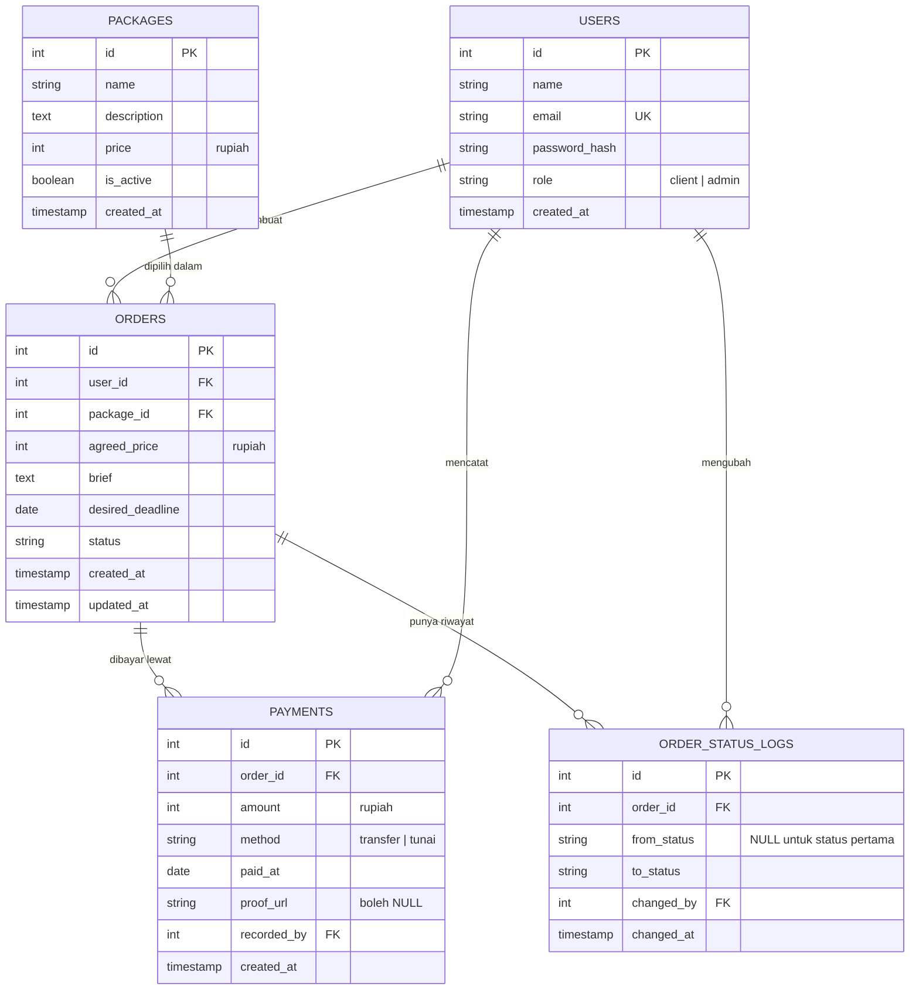

# ERD: Sistem Pemesanan Jasa Website

> Pasangan dari [PRD](01-prd-pemesanan.md). Diagram di bawah dirender otomatis oleh
> GitHub. Kalau dibuka di VS Code, pasang ekstensi Markdown Preview Mermaid Support,
> atau baca versi teks di bawahnya.



## Versi teks

```text
users ||──o< orders >o──|| packages
                │
                ├──o< payments >o──|| users (recorded_by)
                │
                └──o< order_status_logs >o──|| users (changed_by)
```

| Tabel | Kolom penting | Catatan |
|---|---|---|
| `users` | `id` PK, `email` UNIQUE, `role` | klien dan admin di satu tabel, dibedakan `role` |
| `packages` | `id` PK, `price`, `is_active` | paket tidak dihapus, cukup dinonaktifkan |
| `orders` | `id` PK, `user_id` FK, `package_id` FK, `agreed_price`, `status` | satu pesanan = satu paket |
| `payments` | `id` PK, `order_id` FK, `amount`, `recorded_by` FK | satu pesanan bisa dibayar beberapa kali |
| `order_status_logs` | `id` PK, `order_id` FK, `changed_by` FK | riwayat perubahan status |

Semua uang disimpan sebagai bilangan bulat rupiah, bukan desimal.
